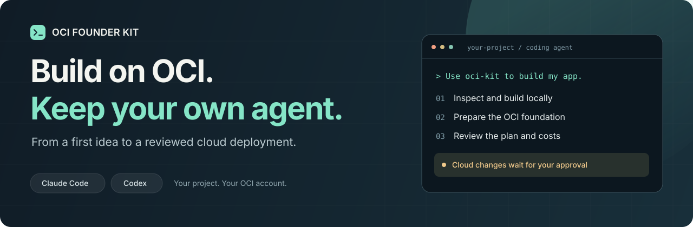
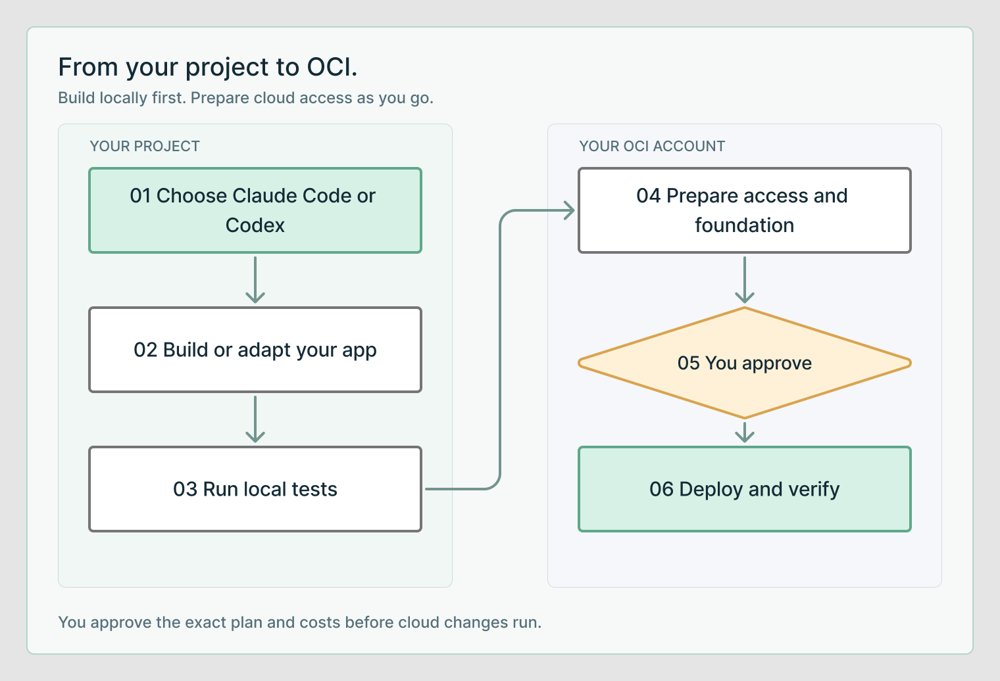

<p align="center">
  <picture>
    <source media="(max-width: 600px)" srcset="docs/assets/hero-mobile.svg" />
    
  </picture>
</p>

# OCI Founder Kit

**An open source starting point for building and migrating apps on Oracle Cloud Infrastructure—with Claude Code or Codex.**

Work in your own project. Get help with credentials, compartments, security and deployment, using OCI Well-Architected guidance. Review the exact plan and costs before cloud changes run.

[**Open the founder guide →**](https://karthiksuku.github.io/oci-founder-kit/) · [Quick start](#get-started) · [Choose your task](#choose-your-task) · [What is tested](#what-is-tested)

## Get started

Use the [interactive start guide](https://karthiksuku.github.io/oci-founder-kit/#start)
to choose your task and agent and copy a prompt shaped around your project.
It runs in your browser and asks for no credentials.

Already using Claude Code or Codex? Open your app's project folder and paste this:

```text
Read https://github.com/karthiksuku/oci-founder-kit and follow its README
installation instructions. Use oci-kit to build my app on OCI.
Inspect this project, help me set up access and a dedicated compartment,
and implement and test locally. Use OCI Well-Architected guidance.
Show the exact cloud plan and costs before making changes.
Never ask me to paste private keys or passwords.
```

Change “build my app” to **“migrate this Vercel app”** or **“set up my OCI foundation”** for your task. Bring your own coding-tool account; OCI access is needed for cloud steps. You can start local development first.

<details>
<summary><strong>Prefer terminal setup? Install into your project</strong></summary>

Requires Git and Python 3.11+. Run from a directory outside your application:

```sh
git clone https://github.com/karthiksuku/oci-founder-kit.git
python3 oci-founder-kit/scripts/install.py --project /absolute/path/to/my-app --agent both
cd /absolute/path/to/my-app
```

The application directory must already exist; it can be empty for a new app. The installer preserves existing files and skills. Choose `--agent codex` or `--agent claude` to install for one tool.

Then start your coding agent inside that project:

| Codex | Claude Code |
| --- | --- |
| `$oci-kit Build my app on OCI.` | `/oci-kit Build my app on OCI.` |

[Full installation guide](docs/INSTALL.md) · [Claude plugin option](docs/INSTALL.md#claude-code-plugin-alternative) · [Updates and troubleshooting](docs/INSTALL.md#update-or-remove-a-project-installation)

</details>

## Choose your task

### Set up OCI

Credentials, access checks and a reviewed compartment/IAM plan. Say **“Use oci-kit to prepare my OCI foundation.”** [Setup guide →](docs/START-HERE.md#oci-credentials-and-initial-setup)

### Build an app

Local implementation, tests and a deployment plan matched to your app. Say **“Use oci-kit to build this app on OCI.”** [Build guide →](docs/START-HERE.md#new-application)

### Migrate an app

Dependency discovery, code adaptation, staging and a cutover/rollback plan. Say **“Use oci-kit to migrate this Vercel app to OCI.”** [Migration guide →](docs/START-HERE.md#existing-vercel-or-netlify-application)

Other cloud workloads are covered by the [AWS, Azure and Google Cloud assessment](skills/oci-migrate-assess/SKILL.md). For a business case, use [OCI economics and AI unit costs](docs/BUSINESS-VALUE.md).

## How it works

<picture>
  <source media="(max-width: 600px)" srcset="docs/assets/workflow-mobile.png" />
  
</picture>

The agent works on your application source. OCI setup uses your own account and permissions. Account enrollment and administrator-only steps stay with you or your administrator; every cloud write waits for approval.

**A foundation is the beginning.** The supplied foundation creates a child compartment and inspection policy under an existing approved parent/group. The agent guides additional workload permissions, networking, HTTPS, secrets, backups and monitoring as separate reviewed changes.

## Designed around OCI Well-Architected guidance

The workflow follows the five OCI pillars: **Security and compliance**, **Reliability and resilience**, **Performance and cost optimization**, **Operational efficiency**, and **Distributed cloud**. Decisions carry evidence, remaining risks and validation steps. [See the review guide →](skills/oci-foundation/references/well-architected.md)

Credentials stay out of chat and Git. Budgets provide alerts rather than hard spending caps. Migration preserves the source while you validate the target and agree rollback. [Security model →](SECURITY.md)

## What is tested

**0.3.1 preview.** The founder website, optional hooks, safer scanners, gated image publication and an opt-in hardened app reference are included. Local builds, agent workflows, container persistence, logical restore and read-only OCI planning have been exercised; the release evidence identifies which version each check covers.

| Verified | Still requires workload-specific validation |
| --- | --- |
| Local app/authentication tests, project installation, website/browser checks, migration packaging and read-only OCI plans | Live OCI application deployment, hosted identity, deployed HTTPS, cloud recovery and traffic cutover |

The container defaults to a restricted sandbox. The [hardened reference](blueprints/fullstack-container/PRODUCTION.md) adds HTTPS, OIDC, per-user access and Vault secrets; verify its deployed controls and recovery before real users. [Read the test evidence →](docs/RELEASE-0.3.1.md)

## Go deeper

[Start guide](docs/START-HERE.md) · [Architecture and capability status](docs/ROADMAP.md) · [Optional hooks](docs/HOOKS.md) · [Reference projects](docs/ECOSYSTEM.md) · [Maintain the kit](docs/MAINTAINING.md) · [Contribute](CONTRIBUTING.md)

Launchpad Studio build briefs can feed the [optional app workflow](skills/oci-build/references/app-workflow.md). Launchpad is not required to use the kit.

---

[UPL-1.0](LICENSE) · Independent project by Karthik Sukumar. Not an Oracle product or endorsement. Product names describe supported tooling and migration sources; no guaranteed credits, compatibility, pricing or certification is implied.
